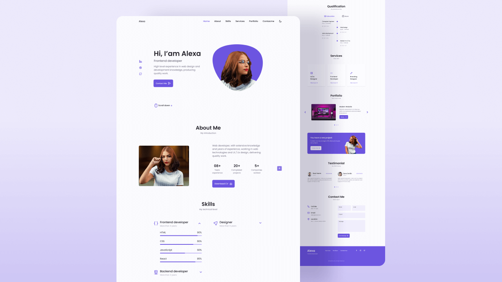
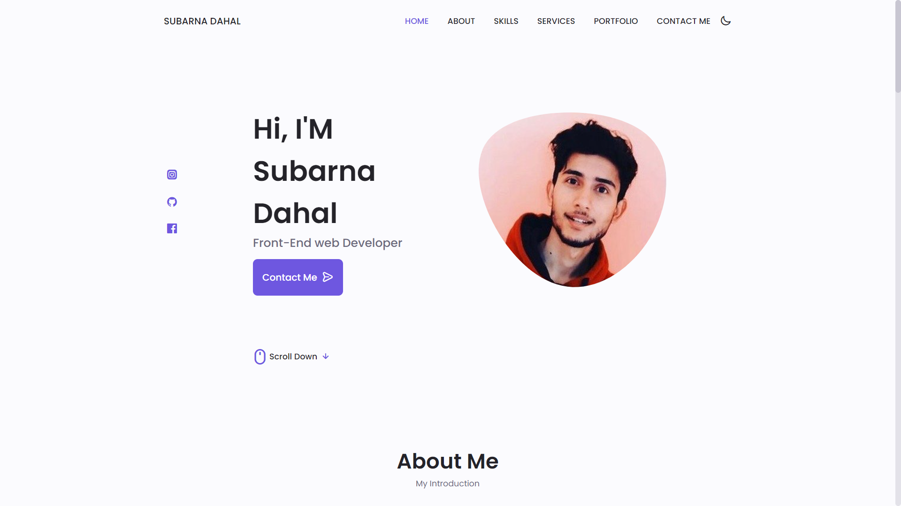
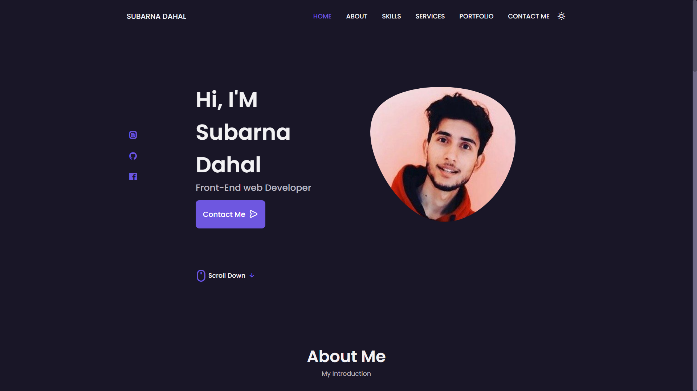
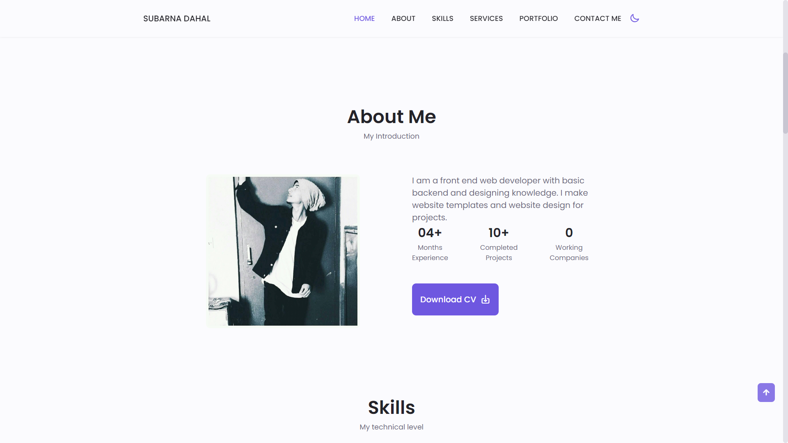
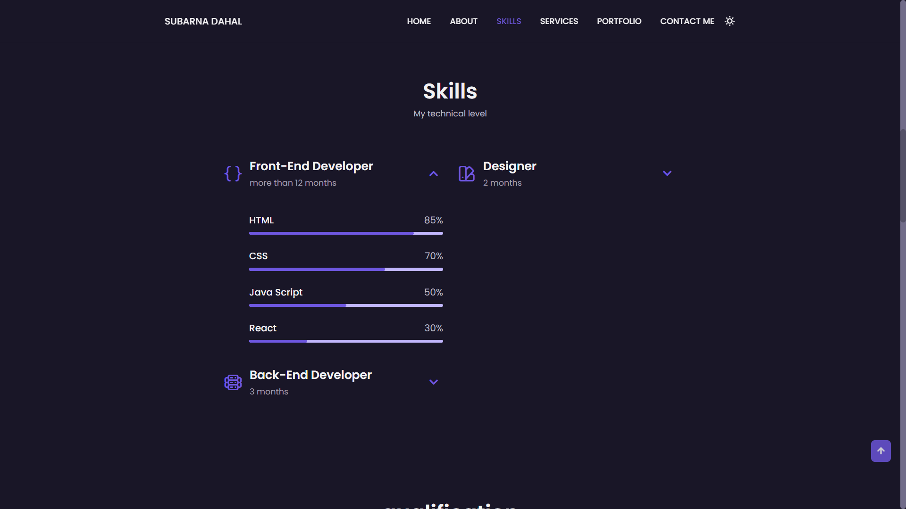
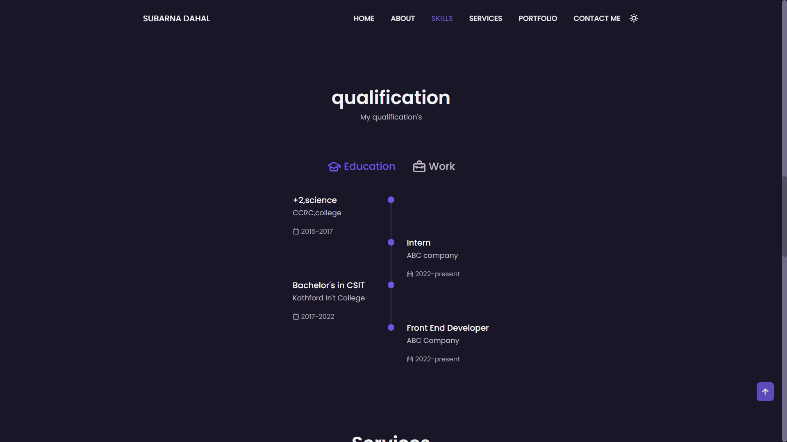
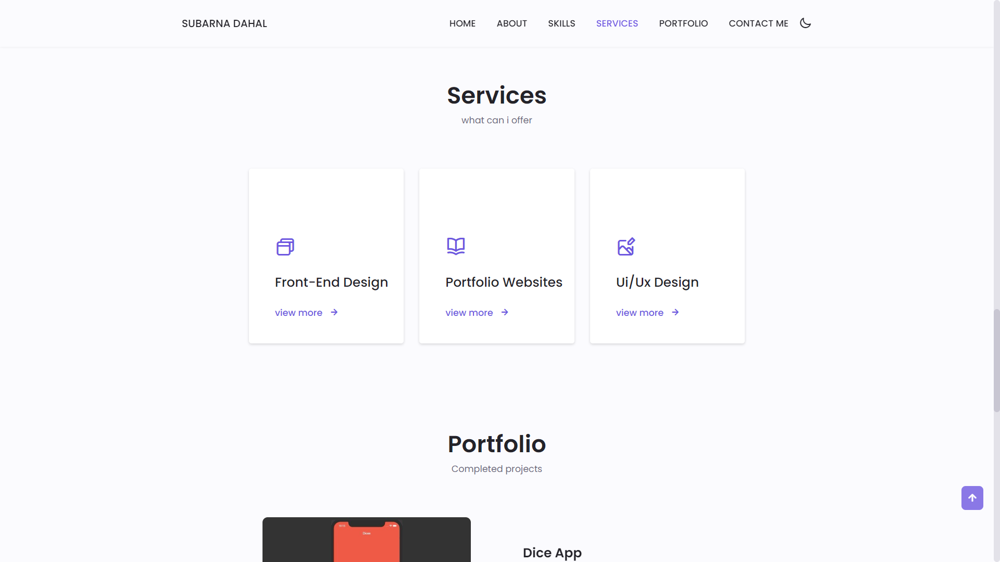
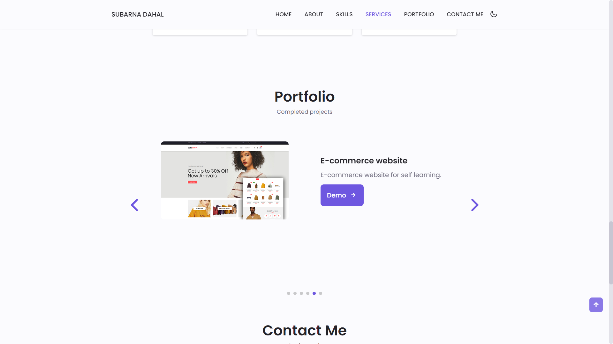
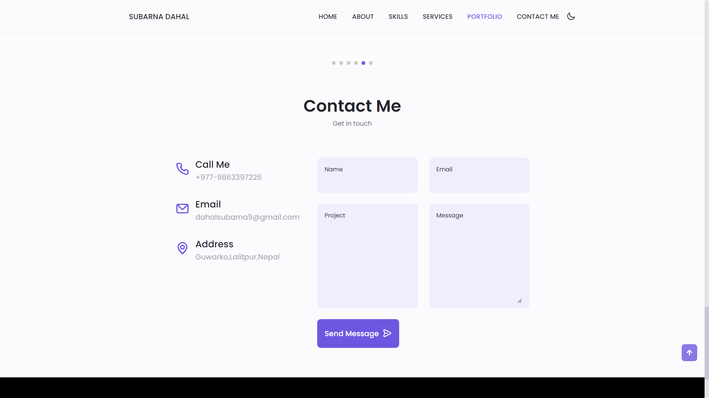

# Personal Portfolio Website

My first portfolio website (published at subarna.netlify.app).

## Features

- Home, about, skills, services, portfolio and contact sections
- Dark and light theme
- Responsive layout

## Run it

No build step. Open `index.html` in a browser, or serve the folder with any static server, for example `python -m http.server`.

## Credits

Layout based on a Bedimcode portfolio tutorial.

## Screenshots

